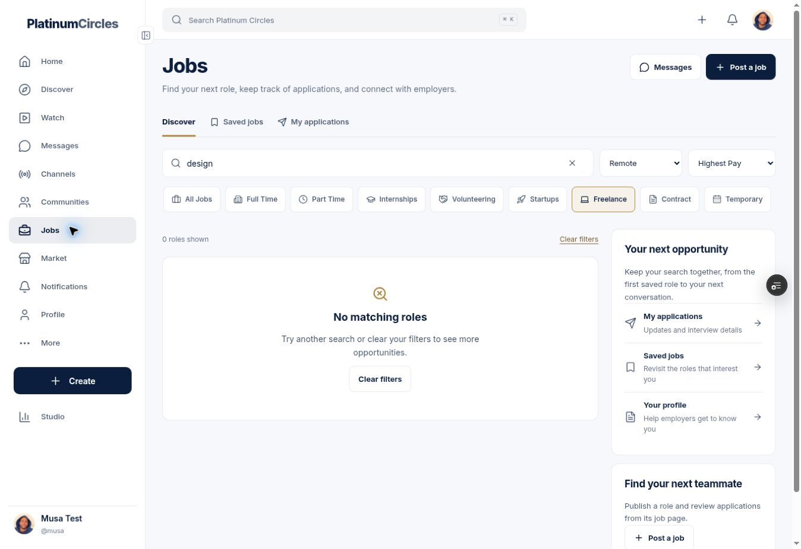
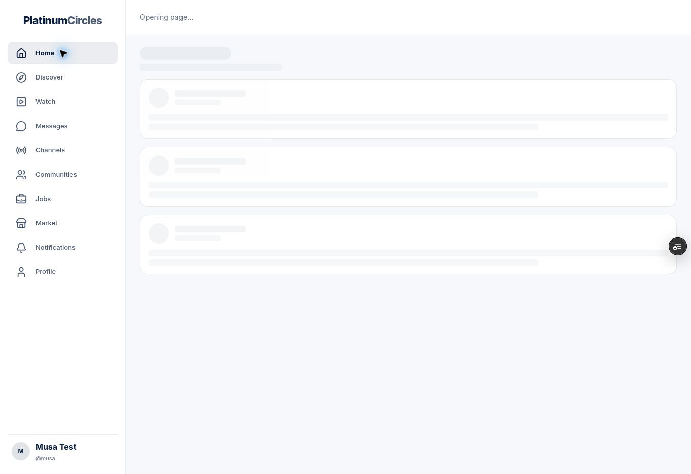
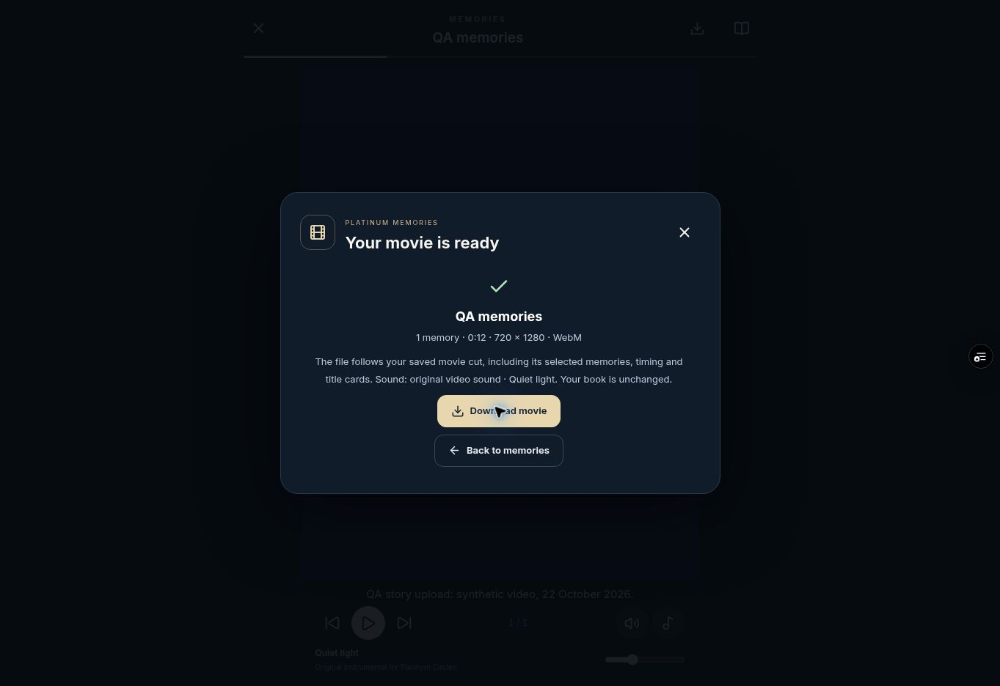
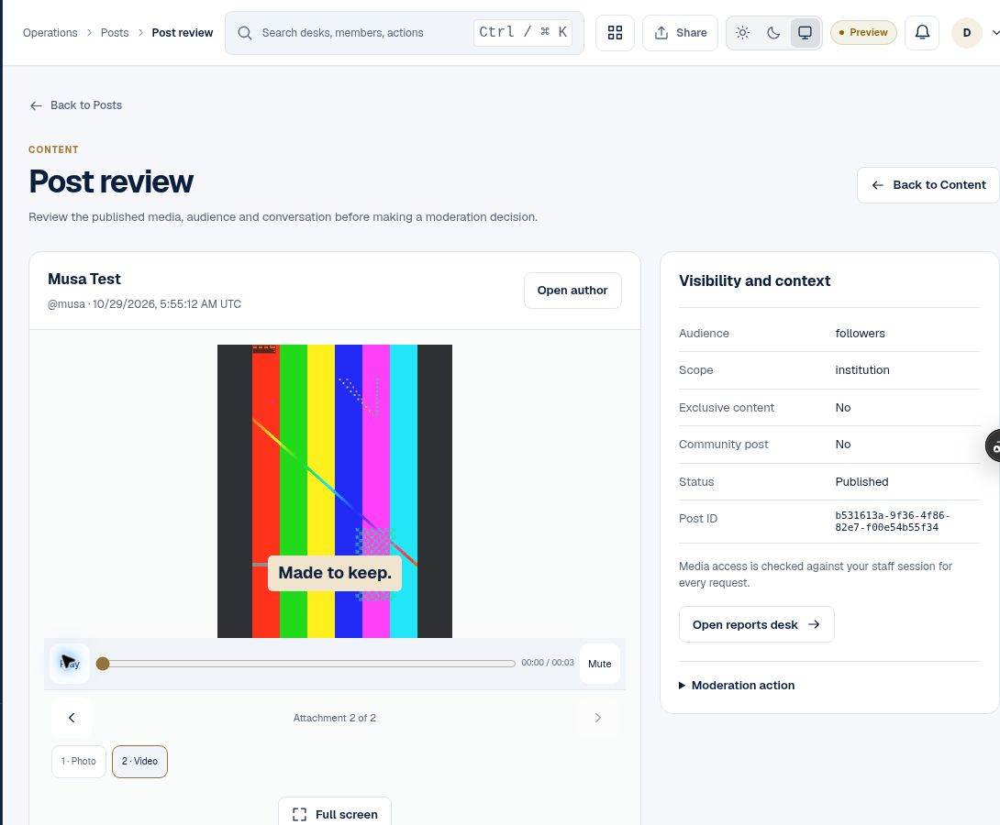
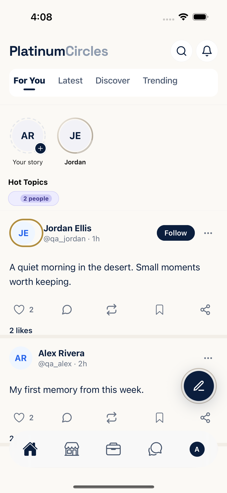
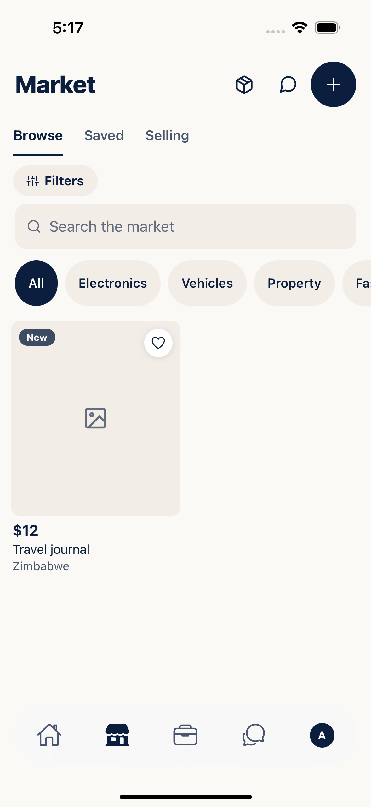

# App reliability and performance continuation

This report records the continuation of the app-wide reliability, navigation and
native acceptance work. It separates implemented changes, observed results and
remaining release gates. It does not claim that every product feature or every
physical-device flow is complete.

The preceding completed type/quality and browser CI checkpoint is
`26e80ae96647884e7f2764bdbb1884fd5aabcff5`. Its tested PR merge is
`6373021f8dcbb2bc614039e74937d2acb0ff2d3e`. Both have tree
`1c10d4cc20fcfd5a0d4e82ba0121c51e90274c03`. Complete native application
acceptance is tracked separately below.

## Published baseline and verified follow-up candidate

The additional native-tab, simulator-storage and cold-web-navigation repairs are
previously published at `ab281bcaab525331930f6238f97e46c169eee1ee`. The fetched PR merge
`f033c50196f6f5f115f451247073ccdb357025d4` has the same tree,
`8e03d00ee3cd707f4095134b5d5c0eec79f5ef19`.

The browser workflow is green, including the new actual-Next loading-navigation
gate. Web quality passed 683 cases, operations passed 195 and Edge TLS passed
two. The root CI suite passed 1,669 of 1,670 cases; its sole failure was a legacy
test harness without the installed React Native style flattener and valid tab
descriptors. The narrow test-only correction retains the original accessibility,
scroll and reduced-motion assertions and passes both the full local root suite
and the separate CI validation described below.
The dependent backend CI steps did not execute after that failure and are not
reported as successful. The correction is saved separately at
`9622cf3076e5eecd8aa14621ee8f5ad6dcc59ff6`, tree
`9bffd16d30397022e6530288475b28cb40783996`. Its one-file validation PR targets the
existing review branch and ran Type/quality without replacing the active native
builds. That run completed successfully: 1,670 root cases, 683 web cases, 195
operations cases and two Edge TLS cases. Its backend Node suite passed 314 cases
with three conditional skips, and isolated RPC TAP invocations passed 883 cases
with three conditional skips. All six skips have observed passing counterparts.
All three TypeScript checks passed. The checkout merge
`76254973415e4123a130647cdb7f1abc0843bf13` has the same tree as the test-only
candidate. Those CI results remain bound to that exact test-only candidate.

The unchanged-source backend fixtures also pass locally: 314 Node cases and 883
isolated RPC TAP cases, with three conditional skips in each invocation mode and
observed passing counterparts for all six. Local execution is recorded separately
from the skipped backend steps in the original CI run.

Complete native acceptance remains open. The iPhone job passed dependency
installation, built, signed, launched and passed Home, Latest and For You. Market
opened with the expected listing, but its exact child-title assertion failed:
iOS exposes the existing grouped card label `View listing: Travel journal`.
All five tab nodes are now present with 72 by 64 point bounds. The Android app
built and reached Market, establishing that the repaired tab geometry permits
the semantic Market tap. The subsequent ambiguous `Home` test selector selected
Android's system Home button and opened the launcher. The retained Maestro log
names `com.android.launcher3:id/home`, and the Android activity log confirms the
launcher transition. This is a test-targeting defect; it does not establish a
crash or a failed app Home transition. Stable app tab identifiers and the
source-reproduced Android timer-bootstrap repair are implemented locally for
the next acceptance attempt. After the subsequent content-selector and required
capture-flow follow-ups, the final combined local root gate passed all 166
selected files: 1,712 formal cases and the separate 33-check auth script. These
new changes are not covered by the earlier PR 6 CI result; fresh native and CI
results must be bound to the published follow-up source.

The current standalone iOS encoders passed all 19 story/memory cases, and both
full integration compiles passed. A separate Android encoder job stopped before
compilation because its emulator ZIP download was corrupt. One retry request
returned no GitHub result before the local wait was interrupted after 1,551.9
seconds. The 05:18:50 UTC metadata still showed only the original jobs. No remote
cancellation, successful retry or encoder acceptance is inferred, and no second
retry was issued.
These are distinct from the successful preceding source checkpoint above.

The verified `ab281bca` web deployment is READY. Admin's build was intentionally
ignored because its entire admin/shared/package input set is unchanged, and the
previous verified READY admin deployment remains in place.

[Current quality receipt](live-app-20261031/ci-quality-ab281bca.json) ·
[Corrected quality CI receipt](live-app-20261031/ci-quality-9622cf30.json) ·
[Current browser receipt](live-app-20261031/browser-quality-ab281bca.json) ·
[Current deployment binding](live-app-20261031/deployment-review-ab281bca.json) ·
[Test-only correction](https://github.com/donadmiral/tbirds-nest/pull/6) ·
[Independent local backend checks](live-app-20261031/backend-fixtures-local-ab281bca.json)

## Changes already implemented

| Area | Resulting behavior |
| --- | --- |
| Native startup | Saved-profile storage starts alongside authentication. Cached content remains hidden until its owner is established. Existing deadlines and session-generation checks are retained. |
| Session continuity | Ordinary token renewal preserves the navigator and warm content. Sign-out and genuine account/session changes invalidate old requests and caches, including A to B to A transitions. |
| Home and Messages | Warm navigation preserves content, scroll, conversation search and drafts. The story strip no longer produces the delayed layout movement found during review. |
| Native Profile | Cached posts are scoped to the current session. Refreshes retain the full loaded list, and delayed media work cannot replace newer captions or counts. |
| Jobs | Cached filters and rows are available on the first render. Results from an obsolete filter or account cannot replace the current list. |
| Notifications | Text and actions become usable before optional media decoration. Invitation cleanup follows actual invitation IDs and does not interpret a failed lookup as permission to remove invitations. |
| Chat | Authorized message history becomes usable before reactions, status and saved/starred metadata finish. Stale work is fenced by the active account and request generation. |
| Incoming calls | Early native answer/end events are replayed once. A final end event supersedes an earlier queued answer. Expiry, current recipient and session authorization are rechecked before opening a call. |
| Android native calls | CallKeep is pinned to 4.6.1 after the complete app exposed the older duplicate native-method startup failure. The dependency is an upstream release, with its locked integrity retained. |
| Memory books | Cover writing, framing, design, movie settings and revision conflicts have connected UI and backend contracts. Text-only books omit photo-framing controls. Small native screens can scroll the closed cover and reach the editor actions. |
| Native verification | Disposable iPhone Simulator and Android Emulator workflows build and launch the complete app with its production screens and native modules. Their isolated transport fixture cannot forward external network traffic. |

At that checkpoint, CI passed 1,638 root/native/shared cases, 672 web cases and
195 operations-app cases. The backend Node suite passed 314 cases with three
conditional skips; isolated SQL TAP invocations passed 883 cases with three
conditional skips. Each conditional skip has a named passing counterpart in the
retained receipt. These overlapping categories are not combined into a unique
test total. All 33 committed startup/auth regression checks pass,
including the two new parallel-cache cases. An independent review also exercised
the actual native navigation-cache reset callback and navigator key across token
renewal and genuine session replacement.

The [navigation evidence](navigation-20261031/resumed-navigation-verification.json)
and [startup follow-up](navigation-20261031/auth-cache-parallel-followup.json)
retain the commands, source hashes and fixture limits. The preceding `26e80ae9`
[CI receipt](live-app-20261031/ci-quality-26e80ae9.json) and
[browser receipt](live-app-20261031/browser-quality-26e80ae9.json) bind all jobs to
the matching source tree. Development browser frame
sampling observed no blank Home or Messages content during the sampled warm
returns. Those samples are not a physical-device or production latency guarantee.

That preceding browser run passed 128 UI workflow scenarios, 18 encoded and decoded
media outputs, and 288 cover layouts with no measured overflow. Its retained
artifact contains measurements and screenshots, not the exported movies; an
independent decode of absent artifact movies is not claimed. Home/Messages,
Jobs and Profile continuity checks retained their expected content across 113,
44 and 45 destination samples respectively. Nested checks are not counted twice
in the 128 parent scenarios.

## Direct checks against the deployed QA app

The existing signed-in QA sessions remained available. The following checks used
the actual branch deployments and hosted QA data, without replacing browser
transport or database responses.

Both primary previews are READY for `26e80ae9`, and their branch aliases were
verified against the exact deployment IDs. A fresh live check on that build kept
Jobs search `design`, Remote location, Freelance type and Highest Pay sort after
Home-to-Jobs navigation. Its genuinely empty dataset remained an empty result
state. Returning from Release gallery to the owner's profile showed both books
and all seven posts in the first captured accessibility view. These observations
are ordinary UI sampling, not a frame-by-frame hosted latency benchmark. The
admin dashboard also showed the rounded data-read label, `395 ms`, correctly
described as current-page reads rather than service-wide health.

The first cold Jobs-to-Profile transition still displayed only the root loading
fallback while the server route resolved. That is distinct from the repaired
warm content caches and led to the additional follow-up below. No
application-origin console error appeared in the retrieved live log.

[Exact preview binding](live-app-20261031/deployment-review-26e80ae.json) ·
[Live follow-up receipt](live-app-20261031/live-navigation-followup-26e80ae.json)

The published `ab281bca` follow-up was also checked directly against hosted QA.
Both cold Notifications and Home transitions visibly retained passive navigation
around the loading view. The Home screenshot below records that actual state.
All four Jobs filters survived a subsequent return; the intermediate Jobs
accessibility snapshot had incomplete text during rendering, so no first-paint
claim is made. The first captured Profile view after returning from Release
gallery retained both books and the seven-post profile. No application-origin
error appeared in the retrieved log for these journeys, and no hosted content
write was submitted.

[Current hosted navigation receipt](live-app-20261031/live-navigation-followup-ab281bca.json)

### Cold-route navigation continuity follow-up

The root loading view now restores passive navigation from the current session's
last committed, server-verified standard app shell. It keeps links usable and
shows an `Opening page…` status without caching page content or mounting unread
queries, calls, lightboxes, scroll listeners, or editable search/compose controls.
The exact owner, scope and revision must still match. Changed or unresolved
sessions and public/auth/professional/unknown routes use neutral loading. A
server-verified guest result clears only the captured session's navigation
snapshot. The temporary avatar accepts only canonical first-party public avatar
URLs; other locators use initials.

Four production web files implement this change. Fourteen focused cases pass,
with clean TypeScript and scoped lint. A separate browser probe used the actual
Next 16.4.3 App Router, proxy, server viewer, async app shell and root loading
component against a synthetic loopback Supabase server. During a deliberately
held profile response, all 136 sampled transition frames retained visible
navigation: 93 outgoing Jobs frames and 43 loading frames. No extra unread query,
editable fallback input, signed-avatar replay or browser error was observed.
The fallback Jobs link interrupted the pending Profile route, and releasing the
late response did not replace Jobs. Collapsed sidebar/content geometry remained
aligned at 76 pixels during the cold Notifications transition.

An independent touch-emulation check also passed at 390 × 844 and 360 × 800.
All five navigation links remained within the viewport with no horizontal
overflow: targets measured 68 × 52 and 62 × 52 CSS pixels respectively, separated
by four pixels. Each center hit test passed, and Jobs interrupted the held
Profile response at both widths. The probe dismissed Next's development badge
through its own preferences after retaining the initial obstruction screenshot;
no application geometry was altered. Physical Safari and nonzero safe-area
behavior are outside that check.

This establishes visible and usable navigation during a real router wait. It does
not claim lower network latency, persistent navigation DOM or a GPU frame-rate
measurement. The same real-Next probe is registered as a separate required
browser CI step, with screenshots, JSON and server logs retained. Existing gates
and the 20-minute job limit are unchanged. Its first published-build CI execution
passed in 13 seconds, and the direct hosted check above confirms the deployed
fallback is visible.

[Follow-up and source hashes](navigation-20261031/cold-shell-followup.json) ·
[Actual Next routing probe](navigation-20261031/cold-shell-next-browser.json) ·
[Independent review](live-app-20261031/navigation-loading-independent-review.json) ·
[Mobile geometry and interaction](navigation-20261031/cold-shell-mobile-independent.json) ·
[CI registration](navigation-20261031/cold-shell-ci-registration.json)

### Web navigation and books

Home and Messages opened successfully. A conversation search remained unchanged
after navigating to Home and returning to Messages. The temporary search text was
cleared after the check.

The existing four-page Release gallery opened from the profile. The reader turned
to its second page. Continuous-film playback could pause and advance manually.
The cover editor exposed its saved title, style, inscription, photo framing,
movie timing and audience controls.

That gallery contains an animated sticker. Its export dialog correctly disabled
creation and identified the unsupported animation. This is an unfinished export
capability, not a successful movie export. The separate single-video QA memories
book was supported and completed the full export and authorized download flow.

| Independent inspection of the downloaded file | Result |
| --- | --- |
| Container and video codec | WebM, VP9 |
| Resolution | 720 × 1280 |
| Duration | 12.001199 seconds |
| Decoded video frames | 360 |
| Reported frame rate | 30 fps |
| Largest observed frame gap | 37 milliseconds |
| Audio | Stereo Opus, 48 kHz, non-silent decoded samples |
| Full-file decoding | Exit 0, no decode errors |
| File size | 3,440,137 bytes |
| SHA256 | `91e2b6fda2dba487268464449fcdfe573d1b6927b243a82b35eb248cbcd2c07f` |

The decoded frame preserved the synthetic source video, its aspect ratio and the
saved caption. The actual UI reported the original audio and the built-in Quiet
light soundtrack. This establishes a real hosted-QA browser export using the
existing synthetic video, rather than physical iPhone or licensed-catalogue
acceptance.

[Export receipt](live-app-20261031/live-memory-export.json)

### Operations app

The deployed dashboard loaded its QA activity and current daily analytics. Its
top-content link opened the staff Post review route. The protected photo loaded
at 1080 × 1920, opened fullscreen and returned focus to its originating button
when closed. The next attachment loaded its saved three-second trim and played
with the saved artwork inside the operations app.

No application-origin error appeared in the captured console errors for these
targeted web/admin journeys. The browser extension emitted metadata errors, which
are counted separately in the receipts. No moderation action, message, post,
profile edit or saved-book change was submitted during these checks.

[Operations receipt](live-app-20261031/live-admin-review.json)

### Own-profile return continuity

The live check found that returning from a book to the viewer's own web profile
recreated empty posts and shelf state. The follow-up now restores only the current
owner's in-memory snapshots, refreshes all loaded pages in the background and
invalidates saved-book revisions when content changes off-route. Other people's
content still waits for current server visibility. Expired signed media locators
are stripped, and account/session changes cancel obsolete work.

The actual-component browser suite passed all 41 social scenarios, including five
new profile cases. Across 44 destination-profile samples during held refreshes,
the existing post and four books remained present with no loading or blank
profile sample. The first profile observation was 65 milliseconds after Back.
This is component continuity evidence using synthetic transport and route
adapters, not a hosted routing or physical-device latency benchmark. The actual
editor also saved a new title and private visibility, and the returned shelf used
the new revision. Eight rapid shelf changes cancelled the stale read and
coalesced into one replacement read. Focused Node execution passed 33 cases,
with clean TypeScript and scoped lint results.

[Profile follow-up and source hashes](navigation-20261031/warm-profile-followup.json)

The additional hosted checks found a separate web Jobs continuity defect:
search, location and job type reset after Home-to-Jobs navigation. Its follow-up
now restores filters, loaded rows, saved IDs, city and scroll under the original
navigation session. It preserves successfully loaded empty results and keeps
usable content while an unsuccessful refresh offers retry. Unused poster-profile
enrichment was removed.

Independent review reproduced two save races. A confirmation from the previous
page instance could lose to a stale replacement-page read, and an implicitly
authorized write could obtain a newer session token after A to B to A. Scoped
confirmation events and mutation revisions now protect the replacement page.
Save requests check their original session, pin authorization and cancel on a
session change. Already-dispatched same-session saves may finish after ordinary
route navigation. Cancellation cannot undo a write already committed by the
server.

Final verification passed 23 focused/parity Node cases and all 25 commerce browser
scenarios, with clean TypeScript and scoped lint. Seven focused Jobs browser cases
include held-refresh navigation, empty results, cross-mount save confirmation,
failed-refresh retry and account replacement. Across 43 destination samples,
eight rows, search, location, type, sort and scroll remained present. The first
Jobs observation was 51.5 milliseconds after return. These component-fixture
measurements have the same routing and device limitations as the profile proof.

[Jobs follow-up and source hashes](navigation-20261031/warm-jobs-followup.json)

Notifications and Messages also loaded their genuine hosted-QA empty states
without an application-origin console error. Immediate automated navigation
showed a root loading fallback while some server routes resolved. Those
observations are retained without a blanket navigation-speed claim.

[Additional live navigation observations](live-app-20261031/live-extra-navigation-before-jobs-fix.json)

## Native acceptance

The preceding `26e80ae9` standalone encoder jobs passed 58 CI cases: 11 iOS memory, 8 iOS
story and 39 Android cases. ZIP digests, 57 retained media hashes and sizes, and
the recorded implementation/acceptance source hashes were verified against
`26e80ae9` and its identical merge tree. Those encoder and acceptance sources
equal the preceding `341395c6` sources. The new artifacts were not independently
decoded again. The earlier independent decoding verified cadence, duration,
color and alpha, timed artwork, voiceover silence and audio timing/pitch.

[Preceding encoder receipts and source equivalence](native-full-app-20261031/native-encoders-26e80ae9-source-equivalence.json)

- [iOS memory receipt](native-full-app-20261031/ios-memory-341395c6-receipt.json)
- [Independent iOS memory decode](native-full-app-20261031/ios-memory-341395c6-independent-decode.json)
- [iOS story receipt](native-full-app-20261031/ios-story-341395c6-receipt.json)
- [Independent iOS story decode](native-full-app-20261031/ios-story-341395c6-independent-decode.json)

These standalone checks use the arm64 iOS 26.2 simulator toolchain. The complete
app acceptance uses an Intel iPhone 16 Simulator running iOS 18.5 and a separate
Android Emulator. Full Swift and Kotlin integration compiles are green at both
`341395c6` and `26e80ae9`. Complete-app runtime acceptance remains separate from
those compiles and the standalone encoders.

The `ab281bca` complete integration compile jobs also passed on both platforms.
Their diagnostic ZIP hashes, embedded tested merge and all seven recorded native
source hashes were verified. The Android compile receipt continues to advertise
memory-movie capability zero. The current standalone iOS story/memory jobs passed
19 cases; the separate Android encoder job stopped at the emulator download.

[Current integration compile receipt](native-full-app-20261031/native-compile-ab281bca-status.json) ·
[Current iOS encoder source binding](native-full-app-20261031/ios-encoders-ab281bca-source-equivalence.json) ·
[Android emulator installation failure](native-full-app-20261031/android-encoders-ab281bca-install-failure.json)

The earlier `341395c6` iPhone app built, installed, signed in and passed its Home,
Latest and For You assertions. The `26e80ae9` Android app also built and passed
those assertions. Its former CallKeep bridge crash and unsolicited microphone
prompt no longer blocked Home. Neither run could make the next semantic Market
tab tap: the icons were visible, but the native accessibility tree omitted the
whole bottom bar. Book navigation and capture were therefore not reached.

[Native compilation status](native-full-app-20261031/native-compile-26e80ae9-status.json) ·
[iPhone runtime failure](native-full-app-20261031/ios-full-app-341395c6-failure.json) ·
[Android runtime failure](native-full-app-20261031/android-full-app-26e80ae9-failure.json)

The `26e80ae9` iPhone full-app job stopped during `npm ci` with `ETIMEDOUT`, before
native preparation, compilation or app runtime. The other iOS dependency install
completed. An exact-job retry was attempted once; GitHub rejected it because the
sibling Android job was still running. This is a recorded infrastructure failure,
not evidence of a new native source defect. Android and the earlier iPhone
baseline were preserved through completion. The iPhone install step now retries
the same locked install once only when npm reports the exact observed timeout
code. Five shell-executed cases distinguish success, retry success, repeated
timeout, integrity failure and incidental timeout text. Dependency integrity and
all app assertions remain unchanged.

[iPhone install failure](native-full-app-20261031/ios-full-app-26e80ae9-install-failure.json) ·
[Bounded install retry](native-full-app-20261031/ios-install-timeout-retry.json)

The Android source follow-up separates passive native registration from media
permission requests. Microphone/camera access remains tied to an explicit call
action. Disabled phone accounts use the existing notification fallback. Cold
Android native events also subscribe before registration drains the queue. The
focused checks pass 15 native-event cases, 23 calling cases and 19 recipient/access
cases. Seven new cases execute the installed CallKeep facade. The corrected
Android complete-app run now establishes the absence of the unsolicited prompt
in this synthetic sign-in flow; physical incoming-call delivery is still separate.

### Bottom navigation geometry repair

The absolute BottomTabBar was drawn outside an animated parent with zero height.
The repair gives that parent explicit bounds around the existing floating bar.
The shown bar position and available content height stay unchanged. Ordinary
non-absolute bars retain their natural layout. Existing tab labels, roles and
press handlers remain the acceptance targets.

Twelve focused actual-component cases pass. A probe compiled the installed React
Native Yoga implementation and verified the before/after layout at four native
viewport sizes, plus default and relative tab styles. The iPhone portrait parent
changes from zero to 108 points while the bar stays at the same screen position.
The native-driver hide/reveal settings remain; the larger parent changes the
scale pivot slightly. The subsequent `ab281bca` Android run successfully tapped
Market and reached its expected listing. The iPhone run also opened Market and
exposed all five tab nodes in its native accessibility tree with 72 by 64 point
bounds. These observations resolve the earlier missing-tab issue for the
observed journeys. They do not establish all animation behavior or later
navigation acceptance.

[Geometry proof](native-full-app-20261031/native-tab-wrapper-geometry-repair.json) ·
[Independent native-tab review](live-app-20261031/native-tab-independent-review.json)

The Android run's next label-based Home tap selected the system navigation
control, not the application tab. Both the Maestro-selected resource ID and the
system HOME activity transition are retained, along with the Market and launcher
screenshots. The local correction adds the installed navigation version's
`tabBarTestID` option and changes eight main-tab actions to those identifiers.
All page assertions, accessibility labels, event handlers and deadlines remain.
Five new cases execute the actual navigator functions and installed tab views
for personal/business branches on both platforms; they verify identifiers reach
the native Pressable, labels and activation remain intact, and every parsed flow
selector names a rendered tab. These pass alongside 29 existing related cases.
The corrected native flow still requires a new complete-app execution.

[Selector repair and source hashes](native-full-app-20261031/native-tab-selector-repair.json) ·
[System Home collision evidence](native-full-app-20261031/android-tab-selector-system-home-evidence.json)

The iPhone Market assertion failed after successful navigation because its
expected standalone title is a child of an accessible card. The existing
production card exposes `View listing: Travel journal`, and the screenshot shows
the loaded $12 listing. The failure is retained as a failed run. A read-only
follow-on audit found the same grouping risk in the unreached Jobs and Messages
rows and the icon-bearing Edit profile button. The next required selectors will
retain the exact expected content while matching either its standalone node or
its complete segment within the native grouped label; the message's question
mark must remain literal.

[Current iPhone UI and source review](native-full-app-20261031/ios-full-app-ab281bca-review.json)

### Simulator account persistence

The earlier iPhone run also logged SecureStore failures caused by missing
entitlements. The disposable simulator build now uses Xcode's local ad-hoc
signing to generate its simulated application identity. A bounded Mach-O reader
checks the embedded XML and DER sections before and after the existing re-sign,
and separately verifies the host signature. This creates no signed physical-device
release and requires no Apple account login.

The full-app gate now requires successful account-index storage and reloads the
actual production account store through SecureStore after navigation reaches the
capture screen. It compares the synthetic account and current session in memory;
only pass/fail, reload status and account count enter the receipt. The production
account store is unchanged. The combined focused native checks pass 52 Node
cases, including six actual-account-store cases, and nine Python parser cases
invoked by one Node case. TypeScript, scoped lint and shell checks also pass.
The `ab281bca` Mac run now establishes actual Xcode ad-hoc signing, unchanged
embedded XML/DER entitlement sections after re-signing, an empty host-entitlement
dictionary and a successful strict signature verification. Its runtime logs show
two successful one-account index operations and none of the earlier save/index
or required-entitlement errors. The flow stopped before the dedicated reload
route, so saved-account readback, restart persistence and full capture remain
unproved by this run.

[Simulator signing and readback repair](native-full-app-20261031/ios-simulator-keychain-signing-repair.json) ·
[Independent signing/readback review](native-full-app-20261031/ios-signing-readback-independent-review.json)

[Current signing and account-storage review](native-full-app-20261031/ios-signing-account-ab281bca-review.json)

### Auth timing investigation

The earlier Android runtime emitted a five-second Auth lock warning. Its bounded
trace recorded 22 lock operations and 93 storage operations, all fulfilled with
no unfinished or dropped operation. Maximum measured lock wait was 293.071 ms,
hold was 389.205 ms and storage duration was 109.767 ms. That does not explain the
warning or establish a five-second blocked UI.

Independent review matched the installed Auth and Supabase files to their pinned
registry archive integrity and confirmed timer cleanup in those sources. The
published QA trace adds a wall-clock anchor and bounded identities for the timer
functions observed at lock phases. It reads property descriptors without invoking
accessors, replacing timers or modifying SDK locking. Fifteen diagnostic cases
pass, including the actual SDK, redaction, descriptor preservation and bounds.
The source receipt records installed dependency paths and hashes, not a final
Metro bundle attestation. Production Supabase source and deadlines are unchanged.

The new `ab281bca` trace records 25 lock and 99 storage operations, all fulfilled,
with no active or dropped operation. Its first acquisition requests with timer
identities 1/2 and completes with identities 3/4. Source inspection found the
existing Daily Android bootstrap replaces the global timer functions. Its
BackgroundTimer clear function only removes callbacks in its own registry, so
it cannot cancel an acquisition timeout created in the earlier React Native
registry. The trace's first lock fulfills at 106.622 ms; the later warning does
not establish a five-second UI stall.

An isolated reproduction uses the actual pinned Supabase lock, Daily bootstrap
and BackgroundTimer callback implementation. Starting auth before Daily leaves
one old-registry timer after successful completion and produces the observed
warning when that synthetic deadline is delivered. Starting Daily first retains
the same auth result and callback count, clears the callback and emits no false
warning. An iOS control retains its original timer functions. Native modules and
timer delivery are simulated in this source-level mechanism check.

The local repair initializes the already-used Daily module before production App
imports. The disposable QA entry does so after its configuration guard and
synthetic transport installation, before linking or App imports. Six functional
cases execute both entry files and the installed implementations, including
wrong-configuration rejection and a genuinely contended lock that still rejects
at its configured 5,000 ms deadline. The existing 15 diagnostic cases also pass.
No SDK lock, timeout, clock provider, warning behavior or native capability flag
is replaced. A fresh Android trace must verify stable timer identities and the
absence of this warning in the complete app.

A separate clock-origin switch can make the diagnostic observer clamp durations
in a synthetic VM. The new emulator snapshot spans 31.219 seconds, with 298
distinct increasing event timestamps through 30.992 seconds, and does not
exhibit that signature; the pinned React Native runtime
initializes Performance before app startup. That hypothetical mechanism does not
justify a clock change here.

These observations add instrumentation overhead and are diagnostic evidence,
not an uninstrumented production performance benchmark.

[Auth diagnostic candidate](live-app-20261031/native-auth-diagnostics-candidate.json) ·
[Independent warning investigation](live-app-20261031/native-auth-warning-26e80ae9-independent-review.json)

[Current artifact and timer investigation](live-app-20261031/native-auth-warning-ab281bca-investigation.json) ·
[Source-level timer reproduction](live-app-20261031/native-daily-timer-switch-repro.json) ·
[Clock-origin diagnostic boundary](live-app-20261031/native-auth-clock-source-switch-repro.json)

The initial combined candidate passed the full local root selection once after both
repairs were frozen: 164 files, including 1,680 formal passing cases and a
separate successful 33-check auth script. There were no formal failures, skips,
cancellations or todos. The CI wrapper counts that legacy script as one file
case. This initial 1,680-case local result precedes the later selector and
required-flow changes; it is retained as historical evidence. Before/after guards retained the same seven frozen
candidate hashes, every test-file hash, test selection and source diff. This
used local Node 24.22.1; the preceding CI checkpoint used Node 22.23.4. Independent
source review found no issue in the initialization order, guard ordering,
installed ID propagation or preservation of genuine timeout behavior.

[Combined candidate regression gate](live-app-20261031/native-v4-root-regressions.json) ·
[Independent entry and tab review](native-full-app-20261031/native-entry-tab-independent-review.json)

The final combined follow-up passed all 166 CI-selected root files in 51.922
seconds on Node 24.22.1: 165 formal-counter files produced 1,712 passing cases,
and the separate auth script passed its 33 checks. No formal failure, skip,
cancellation or todo occurred. This includes 43 new cases: six timer-bootstrap,
five tab-ID, four native content-selector and 28 required-flow orchestration
cases. All 18 frozen source/flow paths, every selected test-file hash, selection
and tracked code diff were unchanged before and after the run. CI's wrapper
counts the standalone script as one case; internal and wrapper counts are not
added together.

[Final combined candidate gate](live-app-20261031/native-v4-final-root-regressions.json) ·
[Content-selector repair](native-full-app-20261031/native-flow-content-selector-repair.json)

Both `26e80ae9` complete-app jobs finished before the `ab281bca` publication. The
existing stable concurrency group remains unchanged. Neither the runner tier
nor acceptance assertions were relaxed. The original iPhone full-app build needed
about 37 minutes, with additional preparation and simulator boot time; standalone
encoder success is not substituted for full-app navigation acceptance. Native
whole-book export remains gated until the actual full-app capture flow passes.

- [Android full-app failure evidence](native-full-app-20261031/android-full-app-341395c6-failure.json)
- [Android permission follow-up](native-full-app-20261031/android-permission-followup.json)
- [Android encoder receipt](native-full-app-20261031/android-encoders-341395c6-receipt.json)
- [Independent Android memory decode](native-full-app-20261031/android-memory-341395c6-independent-decode.json)

The full-app workflow checks actual Profile-to-book navigation, page reading,
film playback, entry to export, creative editing, owner revision persistence and
reopening the saved book. Its additional capture gate uses the production
MemoryMovieExport component and independently decodes the resulting native MP4.
It does not establish physical Photos-library behavior or provider push delivery.

The follow-up now runs navigation once and the unchanged capture flow once as
two required Maestro commands on the same installed app and device. Capture is
attempted even if an earlier navigation assertion fails. Both commands retain
separate logs, screenshots, JUnit and pipeline exit status. Missing, malformed,
empty, skipped, duplicate or incorrectly identified reports fail acceptance;
each report must contain its expected successful case. Failed logging and stale
result reuse also fail. The platform scripts still attempt evidence collection,
independent movie decoding and the complete-app verifier, and any failed phase
keeps the overall job failed.

No new sign-in, state reset, capture retry, timeout widening or runner/concurrency
change is introduced. Both memory-flow assertion files are byte-identical to the
baseline. A pinned Maestro 2.11.0 source review verified 22 official source files
and found that driver cleanup stops Maestro's own infrastructure rather than the
tested app. The next native execution still has to prove real process/session
continuity through the unchanged cumulative book/account/capture requirements.
The 28 actual-shell cases passed both owner and independent review; their
controlled Maestro responses verify orchestration rather than native runtime.

[Required-flow repair](native-full-app-20261031/native-required-flows-repair.json) ·
[Independent required-flow review](native-full-app-20261031/native-required-flows-independent-review.json) ·
[Pinned Maestro lifecycle evidence](native-full-app-20261031/maestro-2.11.0-lifecycle-review.json) ·
[Unconfirmed earlier Android retry](native-full-app-20261031/android-encoders-ab281bca-retry-unconfirmed.json)

## Hosted backend status

The latest saved read-only QA business-auth postflight observed private stage 3.
The catalogue check at 04:48:32 UTC and migration-history follow-up at 04:50:28 UTC
on 2026-10-31 still matched the expected catalogue fingerprint
`2f92a9d038364736fa2413bb6d05a160`.

It verified 99 catalogue records, unchanged migration names/versions/SQL hashes,
no stage 4 private function, no music schema, no notification-event jobs or claim
function, and no active matching business-auth statement.

[Current read-only postflight](live-app-20261031/backend-stage3-postflight-ab281bca.json)

The next migration invocation never returned a success, error, approval form or
rejection. Interrupting the local wait did not prove remote cancellation. The
independent postflight found no stage 4 installation. No alternate SQL bridge,
confirmation bypass or downstream activation followed.

Dependent business Edge rollout and music installation remain held. Commercial
music licensing remains disabled.

[Retained transport and postflight evidence](backend-acceptance-20261031/business-auth-retained-transport.json)

### Reviewed notification alternative

The inspected provider-owned pg_net queues remain readable by application roles,
and the connected database role cannot repair their ACLs. The earlier setup
refused to place a long-lived server credential there.

The new source-only QA candidate uses a private canonical event and a short-lived
one-use capability. The queue contains only the opaque job ID and token. A
service-only atomic claim selects the existing event. A final lease, expiry and
delivery-mode check precedes forwarding to the fixed QA handler. Existing live
recipient, call, account and preference checks remain in those handlers.

Independent execution passed 16 SQL and 14 handler cases. The candidate remains
outside automatic migrations and deployment. The provider's normal confirmation
classification remains intact.

This design avoids duplicate automatic retries after an uncertain outcome. A
worker failure after claim can still lose an attempt. Queue observers can advance
the legitimate event, and queue writers can suppress it. Those remaining limits
and the requirement to drain in-flight work before switching modes are explicit.

[Candidate procedure](../../supabase/ops/qa/notification-event-dispatch/README.md)
and [independent review](backend-acceptance-20261031/notification-event-root-review.json).

## Release boundaries

The four preview deployments are ready for the published checkpoint. The review
branch remains a draft. No production frontend promotion, merge, new signed
build or new TestFlight submission is claimed by this continuation.

The repository retains the Apple team and App Store Connect identifiers and the
historical build 16 receipt. The attempted current App Store Connect browser
check did not complete, so current signed-release access and Apple processing
state remain unverified. Simulator work continues independently.

The remaining release work includes the blocked hosted installation, complete
native UI/capture results, physical-device Photos/camera/interruption and push/call
acceptance, and production private-media/erasure/provider configuration gates.
Animated/nested-video/dual-camera export and the previously documented unfinished
business-delivery features remain outside the verified capability set. No
universal speed, exactly-once provider delivery or whole-product completion claim
is made.
